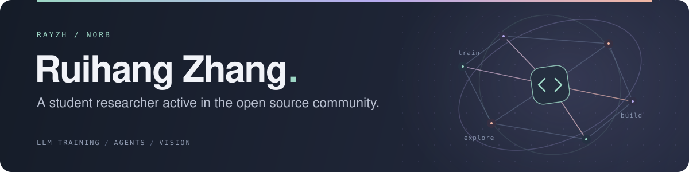

  
  
  
  

<!-- 

  
  
  

-->

## Hi! Nice to meet you :)

I'm a computer science student at [ACM Honors Class](https://acm.sjtu.edu.cn/home) at [Shanghai Jiao Tong University](https://en.sjtu.edu.cn/), and a researcher at [GAIR Lab](https://github.com/GAIR-NLP). You might also know me as **Norb**.

My research focuses on **LLM training**, **agentic scaffolds**, and **LLM visual capabilities**.

My engineering projects span programming languages, computer architecture, and scientific computing. I also build tools for my Arch Linux desktop and explore procedural graphics.

I am a core developer at ACM class, and one of the co-founders of the [ACM Dojo](https://github.com/acm-dojo), an engaging, challenge-based learning platform for computer science freshmen to master CS skills.

<!-- ## Selected engineering projects

| Project | Description |
| --- | --- |
| [**Vox**](https://github.com/RayZh-hs/Vox) | An experimental programming language with focus on modern syntax, a tiered grammar layout, and outstanding performance. Complete with compiler, runtime, REPL, and language server. |
| [**PCL-ME**](https://github.com/theUnknownThing/PCL-ME) | A cross-platform Plain Craft Launcher, co-authored with [TheUnknownThing](https://github.com/TheUnknownThing/) et al. |
| [**Rusty**](https://github.com/RayZh-hs/rusty) | A compiler for a simplified Rust language, written in **Kotlin** as part of SJTU's compiler design course. |
| [**Chisel BOOM**](https://github.com/RayZh-hs/chisel-boom) | A simplified **RISC-V RV32I** processor with out-of-order execution, built with **Scala and Chisel** and inspired by Berkeley BOOM. |
| [**Mango**](https://github.com/Mango-CLI/Mango) | A refreshingly lightweight script management system for everyday tasks. |
| [**VSCode ACMOJ**](https://github.com/TheUnknownThing/vscode-acmoj) | A simple integration of ACMOJ into VSCode, co-authored with [TheUnknownThing](https://github.com/TheUnknownThing/) et al. |
| [**FlowWM**](https://github.com/RayZh-hs/flow-wm) | An experimental **Wayland** desktop that connects windows, commands, scripts, and agents in a node graph. |

You can find a full suite [here at Github](https://github.com/RayZh-hs?tab=repositories&type=source). -->

## My toolkit

**Software Development**

       

**Hardware Development**

 

**Working Environment**

## Recent GitHub activity

<!-- ACTIVITY:START -->
- `2026-11-10` · 🍴 Forked [openai/codex](https://github.com/openai/codex)
- `2026-11-09` · 🔨 Pushed to [RayZh-hs/flow-wm](https://github.com/RayZh-hs/flow-wm/commit/3e0b619e7b419e9d531ff1a69938dca491d06204)
- `2026-11-09` · ⭐ Starred [ccz181078/Coq-BB5](https://github.com/ccz181078/Coq-BB5)
- `2026-11-08` · 🔨 Pushed to [RayZh-hs/flow-wm](https://github.com/RayZh-hs/flow-wm/commit/14485644a46c2fa1f1789f5783d947e312540df7)
- `2026-11-08` · 🌱 Created branch [main](https://github.com/RayZh-hs/flow-wm/tree/main) in [RayZh-hs/flow-wm](https://github.com/RayZh-hs/flow-wm)
<!-- ACTIVITY:END -->

Public activity · <a href="https://github.com/RayZh-hs?tab=overview">View more on GitHub →</a>

## Apart from being a CS student ...

Beyond engineering, I enjoy VFX, photography, and building redstone in Minecraft. Some of that work lives in my [gallery](https://norb.space/gallery).
